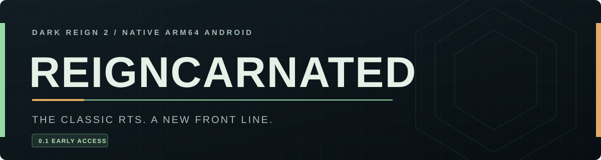

### Dark Reign 2. Back in your hands.

**A 25-year favorite is finding a new home on Android.**

Build your base. Command your army. Take the fight back to the JDA—or join them.

**[Download the 0.1 APK](https://raw.githubusercontent.com/RappuDoggu/Dark-Reign-2-Reigncarnated/1b55b7cab7d571421a64fc192bac5b970563a490/builds/v0.1/Reigncarnated-0.1.apk)** ·
[Player guide](https://github.com/RappuDoggu/Dark-Reign-2-Reigncarnated/blob/recovery/native-arm64-v012/docs/PLAYER_GUIDE.md) ·
[Release notes](https://github.com/RappuDoggu/Dark-Reign-2-Reigncarnated/blob/recovery/native-arm64-v012/docs/RELEASE_0_1.md) ·
[Roadmap](https://github.com/RappuDoggu/Dark-Reign-2-Reigncarnated/blob/recovery/native-arm64-v012/docs/ROADMAP.md)

**Native ARM64** &nbsp; / &nbsp; **Android 8.0+** &nbsp; / &nbsp; **Offline play** &nbsp; / &nbsp; **Early access**

---

## An old favorite. A new front line.

Dark Reign 2 gave us sprawling battlefields, rival factions and the irresistible
urge to build one more army. **Reigncarnated** brings its original engine to
Android, with native ARM64 execution, modern GLES rendering and controls made
for a touchscreen.

The original **10 Hz simulation** stays intact. The classic AI is here. The JDA
and Sprawlers are back on the battlefield. This is a community effort to get a
favorite RTS into our hands again—and keep making it better.

> **0.1 is an early-access candidate, ready for testing.** Instant Action and
> campaign mission access are available. Full campaign playthroughs and remaining
> rendering issues still need work; saves and multiplayer are not implemented.

## Get back into the fight

| Ready to try | What you can do |
| --- | --- |
| **Instant Action** | Choose a map, difficulty and seed. Face the original strategic AI or use practice mode. |
| **Campaigns & cutscenes** | Start either faction's campaign, or select individual imported missions and cutscenes for testing. |
| **Touch command** | Tap to select and order, drag to select groups, pan with two fingers, and anchor, rotate and confirm buildings. |
| **Classic atmosphere** | Original animated menus, native combat and unit audio, plus music and speech support from your imported installation. |
| **Android settings** | Adjust audio, brightness, map pan speed, keep-awake and frame timing display. |
| **Testing tools** | Set your own Instant Action starting resources and export an all-in-one diagnostics ZIP when something goes wrong. |

Campaign selection opens the door to testing every declared mission entry;
it does **not** mean both campaigns have been verified completable. See the
[release notes](https://github.com/RappuDoggu/Dark-Reign-2-Reigncarnated/blob/recovery/native-arm64-v012/docs/RELEASE_0_1.md)
for the current limits.

## Play the 0.1 candidate

1. **[Download and install Reigncarnated-0.1.apk](https://raw.githubusercontent.com/RappuDoggu/Dark-Reign-2-Reigncarnated/1b55b7cab7d571421a64fc192bac5b970563a490/builds/v0.1/Reigncarnated-0.1.apk).** You'll need Android 8.0 or newer, an ARM64 device and GLES 3.0.
2. **Import your own Dark Reign 2 installation.** Use the ZIP or folder importer with the complete game data. The [player guide](https://github.com/RappuDoggu/Dark-Reign-2-Reigncarnated/blob/recovery/native-arm64-v012/docs/PLAYER_GUIDE.md) explains the required files and music import.
3. **Launch Instant Action or a campaign.** Build something. Break something. Tell us what happened.

**Updating from IA City Test?** Install over the existing app. It becomes
**Reigncarnated** and keeps the same package and signer. Avoid uninstalling or
clearing app data, and keep a private game-data backup outside the app.

The APK contains the port; **original game data is imported separately**.

## Help shape the comeback

The next push is about making the experience hold up from the first mission to
the last: campaign objectives and dialogue, rendering and fog of war, save/resume,
and longer Instant Action sessions across more devices. Touch refinements follow
the same goal: keep the tactics, make the phone controls feel natural.

Controllers and multiplayer are longer-term work. Network recovery needs
determinism and peer testing before we can promise a working match.
[Follow the roadmap →](https://github.com/RappuDoggu/Dark-Reign-2-Reigncarnated/blob/recovery/native-arm64-v012/docs/ROADMAP.md)

**Playing on a device we haven't tested? Found a repeatable bug?**
[Open an issue](https://github.com/RappuDoggu/Dark-Reign-2-Reigncarnated/issues).
Include your phone, Android version, app version, map or mission and reproduction
steps. Collect the in-app diagnostics ZIP immediately after the problem. Keep
game archives and unrelated private files out of reports.

If this is your kind of comeback, **star the repository and help us test it**.

## Built to be inspected—and rebuilt

**[Matching source/relink ZIP](https://raw.githubusercontent.com/RappuDoggu/Dark-Reign-2-Reigncarnated/1b55b7cab7d571421a64fc192bac5b970563a490/builds/v0.1/Reigncarnated-0.1-source-relink.zip)** ·
[SHA256 checksums](https://github.com/RappuDoggu/Dark-Reign-2-Reigncarnated/blob/1b55b7cab7d571421a64fc192bac5b970563a490/builds/v0.1/SHA256SUMS.txt) ·
[Build instructions](https://github.com/RappuDoggu/Dark-Reign-2-Reigncarnated/blob/recovery/native-arm64-v012/docs/RECOVERY_BUILD.md) ·
[Development progress](https://github.com/RappuDoggu/Dark-Reign-2-Reigncarnated/blob/recovery/native-arm64-v012/docs/RECOVERY_PROGRESS.md)

The APK identifies its exact source revision. The matching kit includes the port
source, pinned FFmpeg source/configuration and portable relink inputs for **both**
native libraries. Separately extracted relinks reproduce the delivered library
hashes. Host and Android CI, build receipts and download checks provide the
evidence behind the candidate.

<strong>Source branches, toolchain and release status</strong>

The current Android implementation lives on
[`recovery/native-arm64-v012`](https://github.com/RappuDoggu/Dark-Reign-2-Reigncarnated/tree/recovery/native-arm64-v012).
This public landing page is on `main`; the implementation is proposed in
[PR #3](https://github.com/RappuDoggu/Dark-Reign-2-Reigncarnated/pull/3).
Use the recovery branch or matching source kit for current build work.

The 0.1 APK is Android version code 32. It uses SDK 35, NDK 27.2.12479018,
FFmpeg n6.1.1, static libc++ and 16 KiB native alignment. Original engine source is
fetched at a pinned revision and verified against 1,791 file hashes. Signing keys
and original game packs are excluded from the public deliverables.

The download above is a verified candidate from an immutable delivery commit.
The GitHub release is still a draft; this page does not announce a finished or
stable game. See the [build receipt](https://github.com/RappuDoggu/Dark-Reign-2-Reigncarnated/blob/1b55b7cab7d571421a64fc192bac5b970563a490/builds/v0.1/build-receipt.json)
and [GitHub verification](https://github.com/RappuDoggu/Dark-Reign-2-Reigncarnated/blob/recovery/native-arm64-v012/docs/builds/release-0.1-github.json).

---

An unofficial community source port. Original credits and notices are retained;
no publisher endorsement is claimed.
[Source provenance & third-party notices](https://github.com/RappuDoggu/Dark-Reign-2-Reigncarnated/blob/recovery/native-arm64-v012/docs/SOURCE_PROVENANCE.md).
