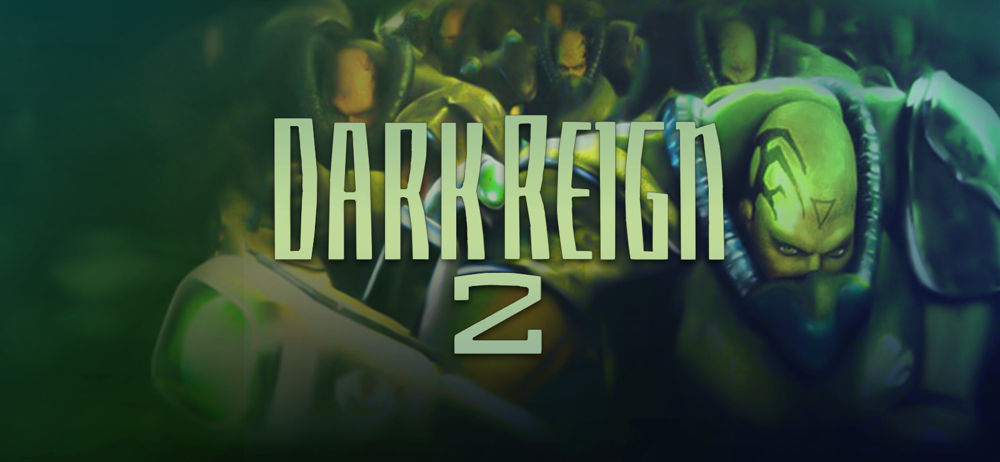

# Reigncarnated

**Dark Reign 2, now on Android.** Native ARM64, with touch controls and the original gameplay.

**[Download 0.1 APK](https://github.com/RappuDoggu/Dark-Reign-2-Reigncarnated/releases/download/v0.1/Reigncarnated-0.1.apk)** · [All downloads](https://github.com/RappuDoggu/Dark-Reign-2-Reigncarnated/releases/tag/v0.1) · [Player guide](docs/PLAYER_GUIDE.md)

## In 0.1

- Instant Action against the original AI, plus practice mode.
- JDA and Sprawler campaign starts, with individual mission and cutscene selection.
- Touch selection, group selection, building placement and rotation, and two-finger map pan.
- Music, unit voices and combat audio from your imported game files.
- Android audio/display settings and diagnostics export.

## Install

Requires **Android 8.0+, ARM64 and GLES 3.0**.

1. Download and install the APK.
2. Import your complete PC installation through the ZIP or folder importer. **Game data is not included.**
3. Choose Instant Action or a campaign.

Updating? Install over the existing app to keep your imported files and progress.
See the [player guide](docs/PLAYER_GUIDE.md) for controls and music import.

## Planned features

- **Multiplayer** — LAN matches, with online play to follow.
- **Mods** — easier import, selection and management.
- **More maps** — additional skirmish maps and custom-map support.
- **Upscaling** — image-quality options and rendering improvements.
- **Zoom and camera controls** — adjustable zoom and better touch controls.
- **Saves and campaigns** — save/resume, campaign fixes and dialogue fixes.
- **Controller support** — configurable controller, mouse and keyboard input.

See the [roadmap](docs/ROADMAP.md). These features are planned, not included in 0.1.

## Known issues

0.1 is an early-access release. Campaigns are not yet verified from start to finish;
rendering, fog, lighting and some dialogue still need fixes. Mid-mission saves and
multiplayer are not available yet. [Release notes](docs/RELEASE_0_1.md).

[Report a bug](https://github.com/RappuDoggu/Dark-Reign-2-Reigncarnated/issues) with your device, Android version, mission/map and the in-app diagnostics ZIP.

[Source ZIP](https://github.com/RappuDoggu/Dark-Reign-2-Reigncarnated/releases/download/v0.1/Reigncarnated-0.1-source-relink.zip) · [Build instructions](docs/RECOVERY_BUILD.md) · [Credits and notices](docs/SOURCE_PROVENANCE.md)
